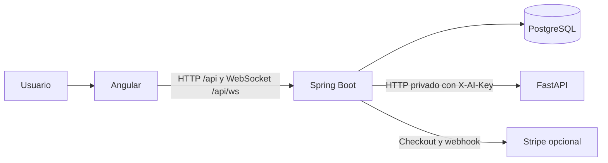

# Power Zone

Sistema de gestión de gimnasios con **Angular 22**, una API **Java 21 / Spring Boot 3.5**, **PostgreSQL 16** y un servicio independiente **Python / FastAPI** para el asistente, las rutinas y las recomendaciones. La API documentada está en [Swagger UI](http://localhost:3000/api/docs) y su contrato JSON en [OpenAPI](http://localhost:3000/api/docs-json).

> Proyecto académico del programa de formación de Analistas y Programadores de Software.

## Arquitectura



Spring Boot es un **monolito modular**: autenticación, usuarios, membresías, pagos, ejercicios, rutinas, clases, asistencia, inventario, nutrición, notificaciones, campañas y reportes comparten una base de datos y un despliegue. FastAPI es un servicio independiente; no requiere separar cada módulo en un microservicio. Los controladores HTTP delegan las reglas a servicios, que usan un adaptador JDBC (`TableStore`). Flyway mantiene el esquema. Consulta [la decisión de arquitectura](docs/ARCHITECTURE.md) para el detalle.

## Funciones conservadas

- JWT con access/refresh, rotación, roles y aislamiento por gimnasio.
- Membresías, pagos manuales, Stripe y checkout de demostración.
- Rutinas, clases, reservas y lista de espera; check-in por tarjeta o QR.
- Aforo y notificaciones en tiempo real por WebSocket autenticado.
- Inventario, nutrición, campañas programadas y reportes; Angular exporta los reportes a CSV.
- Asistente, generación de rutinas y recomendaciones mediante FastAPI. Chat y recomendaciones tienen respuesta local si FastAPI no está disponible.
- Tema claro/oscuro y toda la interfaz Angular existente.

El [OpenAPI original](postman/powerzone-openapi.json) conserva la documentación anterior. Swagger incorpora sus descripciones y esquemas, y expone las 107 operaciones heredadas más las rutas de salud y webhook. El [backend NestJS anterior](legacy/nestjs/README.md) queda archivado como referencia y ya no participa en la ejecución ni en CI. También se conserva el documento [BACKEND POWERZONE](<BACKEND POWERZONE>).

## Inicio rápido con Docker

1. Copia [.env.example](.env.example) a `.env` y define secretos JWT propios.
2. Ejecuta `docker compose up --build` desde la raíz.
3. Abre [Angular](http://localhost:4200), [Swagger](http://localhost:3000/api/docs) o [FastAPI](http://localhost:8000/docs).

Para cargar los datos de demostración, establece `SEED_DEMO=true` en `.env` y vuelve a iniciar los contenedores. El cargador es idempotente y crea seis cuentas (`admin@powerzone.app`, `superadmin@powerzone.app`, `trainer@powerzone.app`, `reception@powerzone.app`, `client@powerzone.app` y `client2@powerzone.app`) con contraseña de desarrollo `PowerZone2024!`, además de planes, pagos, ejercicios, alimentos, clases, asistencia e inventario. Desactiva `SEED_DEMO` fuera de desarrollo.

## Desarrollo local

Requisitos: Java 21 o posterior, Maven 3.9, Node compatible con Angular 22 (`^22.22.3` o `^24.15.0`), Python 3.12 y PostgreSQL 16. Puedes iniciar solo PostgreSQL con `docker compose up db`.

```text
cd backend
mvn spring-boot:run

cd ai-service
python -m pip install -r requirements.txt
python -m uvicorn app.main:app --reload --port 8000

cd frontend
npm ci
npm start
```

Ejecuta cada proceso en una terminal distinta. Angular usa `frontend/proxy.conf.json` para enviar `/api` y `/api/ws` a Spring Boot. Si usas `docker compose -f docker-compose.yml -f docker-compose.run.yml up db`, PostgreSQL queda en el puerto local **5433**; establece `DB_PORT=5433` para el proceso Java local. Las variables de `.env` no se cargan automáticamente al iniciar Java fuera de Docker.

## Migración de una base existente

Haz una copia de seguridad de PostgreSQL antes de cambiar el backend. Flyway crea el esquema desde [V1](backend/src/main/resources/db/migration/V1__initial_schema.sql) en bases nuevas. Para una base ya creada por TypeORM, Flyway registra la versión 1 como línea base y conserva sus datos. Comprueba el esquema y las cuentas antes de abrir tráfico. Los JWT emitidos por NestJS no se aceptan en Spring Boot: los usuarios deben volver a iniciar sesión. La interfaz conserva las rutas HTTP y el formato principal de las respuestas; el canal Socket.IO pasa a WebSocket nativo y requiere la nueva versión de Angular.

## Verificación

```text
python scripts/verify-api-contract.py
mvn -f backend/pom.xml verify
cd frontend && npm ci && npm run build
```

Con PostgreSQL, FastAPI y Spring Boot activos, ejecuta `node scripts/endpoint-smoke.mjs`. El smoke test recorre las 107 operaciones documentadas con datos de demostración y comprueba que Swagger siga publicándolas. Usa `API_BASE_URL` si la API no está en `http://localhost:3000`. CI ejecuta estas verificaciones contra PostgreSQL 16.

## Convenciones de Git

La migración está en la rama `codex/feat-spring-boot-fastapi`. Los cambios se registran con **Conventional Commits** (`feat:`, `fix:`, `docs:`, `chore:`). El código NestJS histórico permanece en `legacy/nestjs` para consulta; el runtime activo está en `backend`, `frontend` y `ai-service`.
